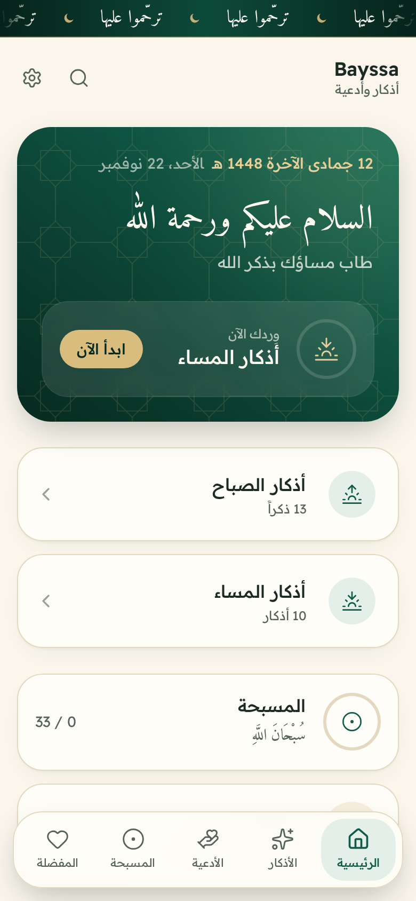
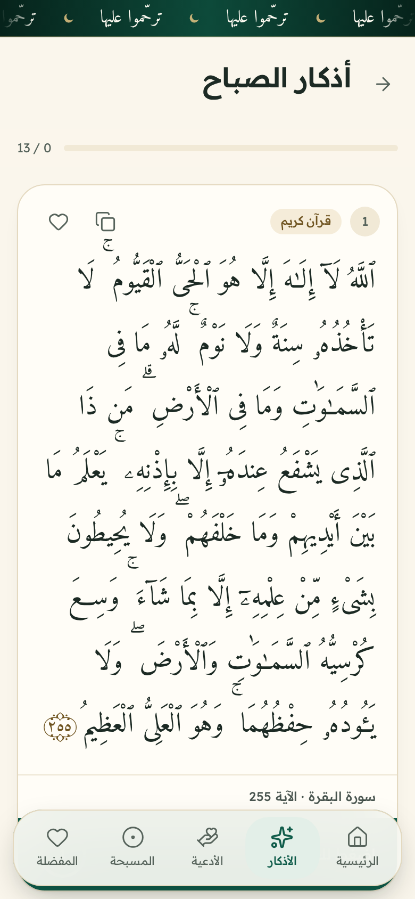
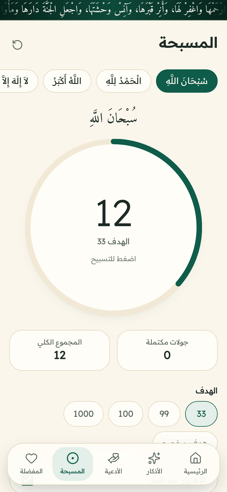
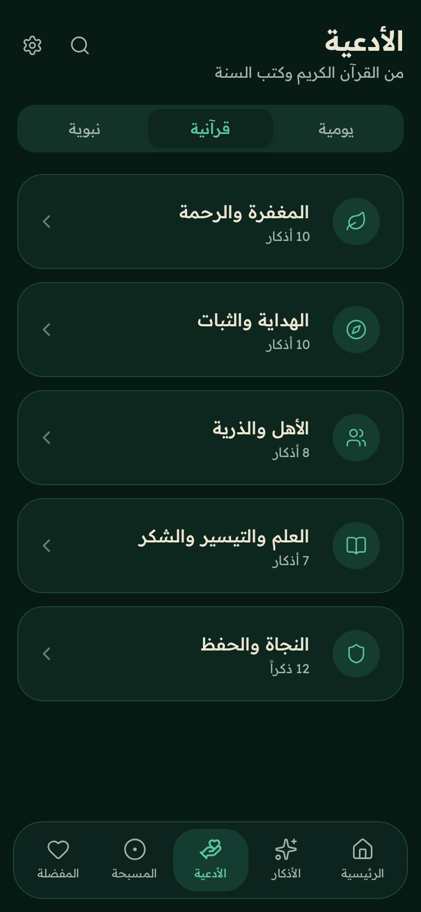
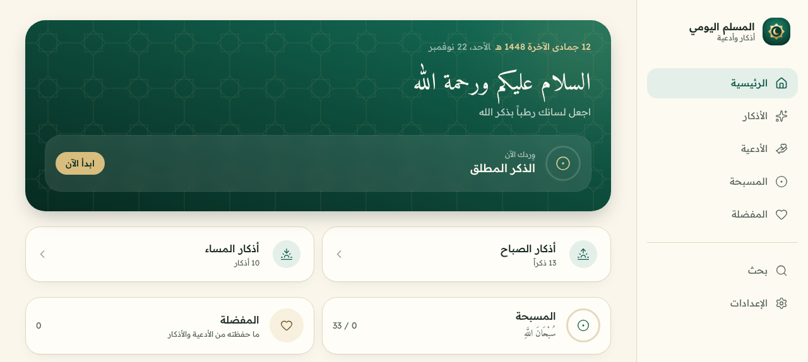
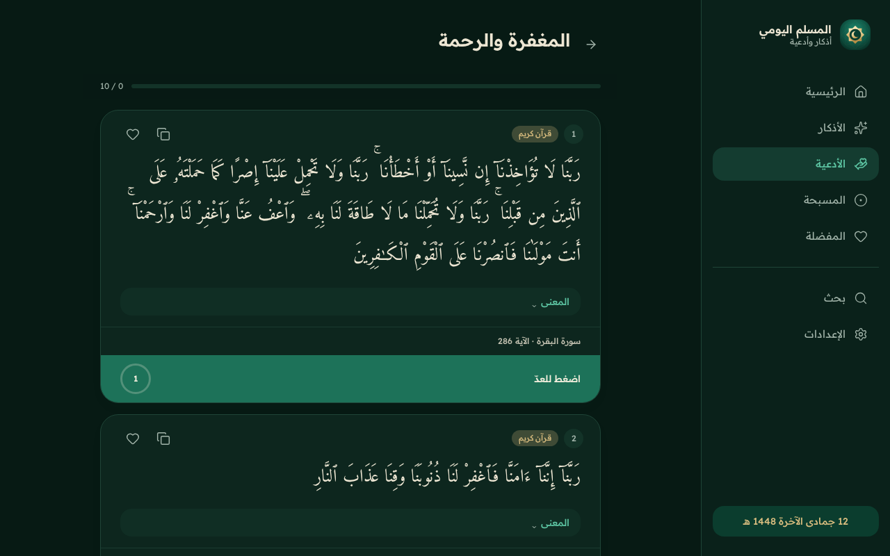

<div align="center" dir="rtl">


# نفيسة

تطبيق ويب عربي للأذكار والأدعية اليومية مع مسبحة إلكترونية، يعمل دون اتصال. وليس تطبيقاً لقراءة القرآن.

العربية · [English](README.md)

</div>

<div dir="rtl">

> [!IMPORTANT]
> محتوى هذا التطبيق طابقه برنامجٌ على مصادره، ولم يراجعه عالمٌ مختص. التطبيق ليس مرجعاً شرعياً معتمداً. انظر [تنبيه شرعي](#تنبيه-شرعي).

## نبذة

«نفيسة» تطبيق ويب تقدّمي باللغة العربية وباتجاه من اليمين إلى اليسار، يجمع ما يحتاجه المسلم في يومه من أذكار وأدعية في مكان واحد هادئ وسريع. يُثبَّت على الشاشة الرئيسية للهاتف، ويعمل دون اتصال، ويحفظ كل شيء على الجهاز. لا حسابات ولا إعلانات ولا تتبّع.

وهو موقع ثابت بلا خادم، مهيّأ للاستضافة على GitHub Pages.

## المزايا

- الأذكار اليومية: الصباح والمساء وبعد الصلاة والنوم والاستيقاظ والذكر المطلق، مع عدّاد للتكرار ومتابعة لما أتممته في يومك.
- أدعية يومية مرتبة بحسب المناسبة وأدعية نبوية، مع اسم الكتاب ورقم الحديث ودرجته منسوبةً إلى قائلها. والأدعية الواردة في القرآن الكريم قسم من أقسامها، يُعرض كل دعاء منها مفرداً مع اسم السورة ورقم الآية.
- مسبحة إلكترونية فيها أذكار جاهزة وأهداف مخصصة وجولات وحركة عند الإتمام واهتزاز اختياري. لا يُصفَّر العدّاد إلا بطلبك.
- مفضلة محفوظة على الجهاز ومرتبة بحسب القسم.
- تصدير المفضلة والعدّادات إلى ملف واستيرادها، مع معاينة قبل التطبيق. وبه تُنقل البيانات بين المتصفح والتطبيق المثبّت.
- بحث عربي يتجاهل التشكيل ويتسامح مع اختلافات الكتابة الشائعة.
- شاشة رئيسية فيها التاريخ الهجري (يمكن تعديله يومين بحسب رؤية الهلال في بلدك) ووِرد مقترح بحسب الوقت وذكر اليوم ودعاء اليوم.
- مظهر فاتح وداكن، وحجم خط قابل للتعديل، وأرقام عربية مشرقية أو مغربية.
- قابل للتثبيت، ويعمل كاملاً دون اتصال بعد الزيارة الأولى، والتحديثات تنتظر موافقتك.

## لقطات الشاشة

| الرئيسية | القراءة | المسبحة | الوضع الداكن |
|---|---|---|---|
|  |  |  |  |

| سطح المكتب | سطح المكتب، داكن |
|---|---|
|  |  |

## التثبيت

افتح الموقع ثم أضفه إلى الشاشة الرئيسية:

- أندرويد، كروم: افتح القائمة واختر «تثبيت التطبيق».
- آيفون وآيباد، سفاري: اضغط «مشاركة» ثم «إضافة إلى الشاشة الرئيسية».
- كروم أو إيدج على الحاسوب: اضغط رمز التثبيت في شريط العنوان.

### المتصفحات المدعومة

يُختبر نفيسة على كروم في أندرويد والحاسوب، وعلى سفاري في آيفون والحاسوب (بمحرك WebKit).

متصفح فايرفوكس غير مدعوم حالياً وليس ضمن الاختبارات الآلية. أثناء الاختبار تعطّلت صفحة الإعدادات فيه أحياناً عند تشغيل فحص إمكانية الوصول، بسبب خلل داخل المتصفح نفسه لم يُعرف سببه. قد يعمل التطبيق على فايرفوكس، لكن لا شيء يتحقق من ذلك.

بعد الزيارة الأولى يفتح التطبيق ويعمل دون اتصال.

## التطوير محلياً

يتطلب Node 24 أو أحدث.

</div>

```
git clone https://github.com/MHChlagou/nafissa.git
cd nafissa
npm install
npm run dev
```

<div dir="rtl">

يعمل التطبيق على العنوان `http://localhost:5173/nafissa/`.

| الأمر | وظيفته |
|---|---|
| `npm run dev` | خادم التطوير |
| `npm run lint` | فحص الشيفرة |
| `npm run typecheck` | فحص الأنواع |
| `npm test` | اختبارات الوحدات |
| `npm run test:e2e` | اختبارات شاملة على نسخة الإنتاج في Chromium و WebKit. نفّذ `npx playwright install chromium webkit` مرة واحدة قبلها. فايرفوكس غير مختبَر. |
| `npm run content:validate` | التحقق من بيانات المحتوى، ومنه مطابقة النص القرآني حرفاً بحرف |
| `npm run content:audit` | إعادة توليد تقارير تدقيق المحتوى (بعد `npm run content:fetch`) |
| `npm run build:public` | بناء نسخة في `dist-public/` لا تحوي إلا ما ثبت حق إعادة نشره، ثم فحص الناتج |
| `npm run test:public` | اختبارات سريعة لتلك النسخة |

## البناء

</div>

```
npm run build
npm run preview
```

<div dir="rtl">

يتحقق البناء من المحتوى ومن الأنواع، ويجهّز الشاشة الرئيسية صفحةً ثابتة، ويكتب الموقع وعامل الخدمة في المجلد `dist/`.

## النشر على GitHub Pages

1. أنشئ مستودعاً باسم `nafissa`. إن اخترت اسماً آخر فغيّر `BASE_PATH` في `vite.config.ts`.
2. في إعدادات المستودع، قسم Pages، اجعل المصدر «GitHub Actions».
3. في الإعدادات، قسم Secrets and variables ثم Actions ثم Variables، أضف متغيراً باسم `DEPLOY_PAGES` قيمته `true`.
4. ادفع إلى الفرع `main`. يتولى الملف `.github/workflows/ci.yml` التحقق من المحتوى وتشغيل كل الاختبارات والبناء والنشر.

النشر معطّل افتراضياً. دون هذا المتغير، أو في مستودع خاص، يكتفي سير العمل بالتحقق والبناء ولا ينشر شيئاً.

يُنشر الموقع على `https://mhchlagou.github.io/nafissa/`.

## العمل دون اتصال

- تُحفظ كل ملفات التطبيق عند الزيارة الأولى، ومنها المحتوى والخطوط. بعدها لا يرسل التطبيق أي طلب إلى الشبكة، ولا يتصل بأي طرف ثالث في أي وقت.
- عند صدور نسخة جديدة يظهر إشعار، وتبقى النسخة الحالية تعمل حتى توافق، فلا ينقطع ذكرٌ بدأته.
- المفضلة وأعداد التسبيح والتقدم والإعدادات محفوظة في تخزين المتصفح على جهازك.

## التقنيات

React 19 و TypeScript و Vite 8 و Tailwind CSS 4 و React Router و Motion و Lucide و vite-plugin-pwa و Vitest و Playwright. الخطوط: Amiri للقرآن والأدعية، و Readex Pro للواجهة، وكلاهما مستضاف مع التطبيق.

## مصادر المحتوى ومنهج التوثيق

لا يُكتب أي نص ديني في هذا المشروع باليد. يقتطع برنامجٌ كل كلمة تُتلى من مصدرها.

- القرآن الكريم: النص بالرسم العثماني من [مشروع تنزيل](https://tanzil.net)، الإصدار 1.1، ويُعرض كما هو. وعند كل بناء يُقارَن كل موضع قرآني بملف تنزيل حرفاً بحرف، ويتوقف البناء عند أي اختلاف.
- الأدعية والأذكار: من كتاب «حصن المسلم» للشيخ سعيد بن علي بن وهف القحطاني، ثم تُقارَن آلياً بنصوص الكتب الستة (البخاري ومسلم وأبو داود والترمذي والنسائي وابن ماجه).
- لا يُنشر الدعاء إلا إذا وُجد لفظه في أحد هذه الكتب برقم يمكن ذكره، وكان عدد تكراره منصوصاً في المصدر، وكان في الصحيحين أو نُقل تصحيحه أو تحسينه عن عالم مذكور باسمه.
- مطابقة النص نوعان: تامة (اللفظ موجود كما هو) وتقريبية (تسعة أعشار الكلمات على الأقل موجودة بترتيبها). ويُشار إلى التقريبية على بطاقة الدعاء.
- ما لا يجتاز التحقق يبقى في المستودع ولا يظهر في التطبيق. وقد يُحجب دعاء بقرار تحريري موثّق.

الأرقام الحالية: 205 مدخلاً منشوراً (51 موضعاً قرآنياً، و120 مطابقة تامة، و34 مطابقة تقريبية)، و77 محجوباً.

تفصيل المنهج ومواطن ضعفه المعروفة وتدقيق كل مدخل منشور في [`content-sources/README.md`](content-sources/README.md) و [`docs/pre-release/content-audit.md`](docs/pre-release/content-audit.md) (بالإنجليزية).

## تنبيه شرعي

- التوثيق الموصوف أعلاه آلي: برنامج قارن الحروف. ليس حكماً بصحة حديث، وليس مراجعة عالم.
- لم يراجع هذا المحتوى عالمٌ مختص. التطبيق غير معتمد ولا مُجاز من أي عالم أو جهة شرعية.
- المطابقة باللفظ قد تربط الدعاء بحديث ورد في مناسبة أخرى. وجد التدقيق حالات من هذا النوع وأُزيلت، وقد يبقى غيرها. ورقم الحديث المذكور قد يكون واحداً من عدة أحاديث تحمل اللفظ.
- درجات الأحاديث منقولة من قاعدة بيانات خارجية مع اسم من نُسبت إليه، وليست حكماً من المشروع.
- في الأحكام، وفي كل ما تهمّك دقته، ارجع إلى أهل العلم وإلى الكتب الأصلية.
- إن وجدت خطأ فافتح بلاغ «تصحيح محتوى» واذكر مصدرك.

## الخصوصية

لا حسابات ولا إحصاءات ولا إعلانات ولا ملفات تعريف ارتباط. لا يرسل التطبيق أي شيء عنك إلى أي مكان. المفضلة والأعداد والإعدادات تبقى في تخزين المتصفح على جهازك، وتزول إن مسحت ذلك التخزين. ولا يحمّل التطبيق أي ملف من طرف ثالث.

## الترخيص

لا يسري على هذا المستودع ترخيص بعد. والمقرر فصل أمرين:

- شيفرة التطبيق المصدرية، وستصدر بترخيص Apache 2.0 بعد اكتمال مراجعة التراخيص؛
- محتوى الغير (نصوص الأدعية والآيات والخطوط)، ويبقى على شروط أصحابه ولا يشمله ترخيص الشيفرة. انظر [`THIRD_PARTY_CONTENT.md`](THIRD_PARTY_CONTENT.md).

وما زال الإذن مطلوباً في مصدر من مصادر المحتوى، ويُتحقق من أصل بيانات المراجع. انظر [`docs/pre-release/licensing.md`](docs/pre-release/licensing.md).

## شكر وتقدير

- [مشروع تنزيل](https://tanzil.net) على النص القرآني المدقق.
- الشيخ سعيد بن علي بن وهف القحطاني رحمه الله، مؤلف «حصن المسلم».
- مشروع [fawazahmed0/hadith-api](https://github.com/fawazahmed0/hadith-api) على قاعدة بيانات الحديث المفتوحة.
- خالد حسني ومشروع خط Amiri، ومؤلفو خط Readex Pro.
- مؤلفو المكتبات المفتوحة المذكورة أعلاه.

## المساهمة

انظر [`CONTRIBUTING.md`](CONTRIBUTING.md). تصحيحات المحتوى موضع ترحيب خاص، ولها إجراءات أشد من إجراءات الشيفرة.

</div>
