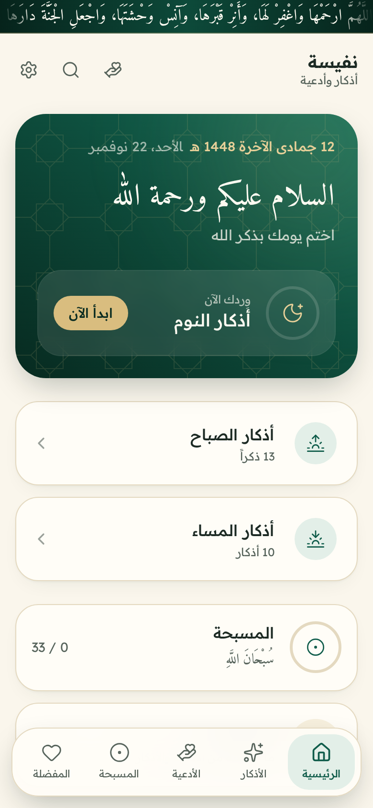
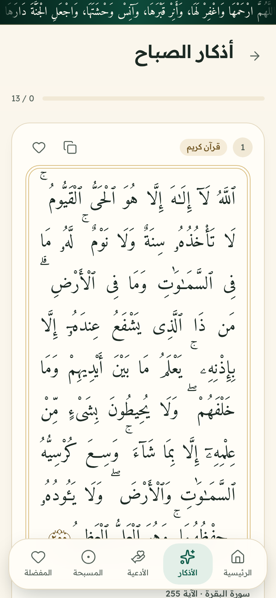
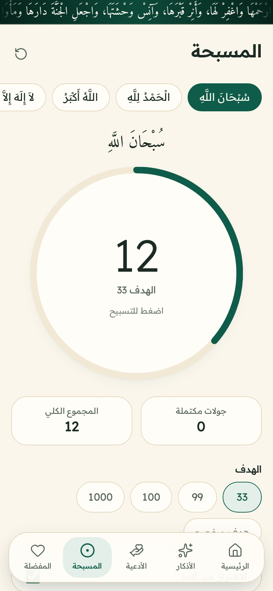
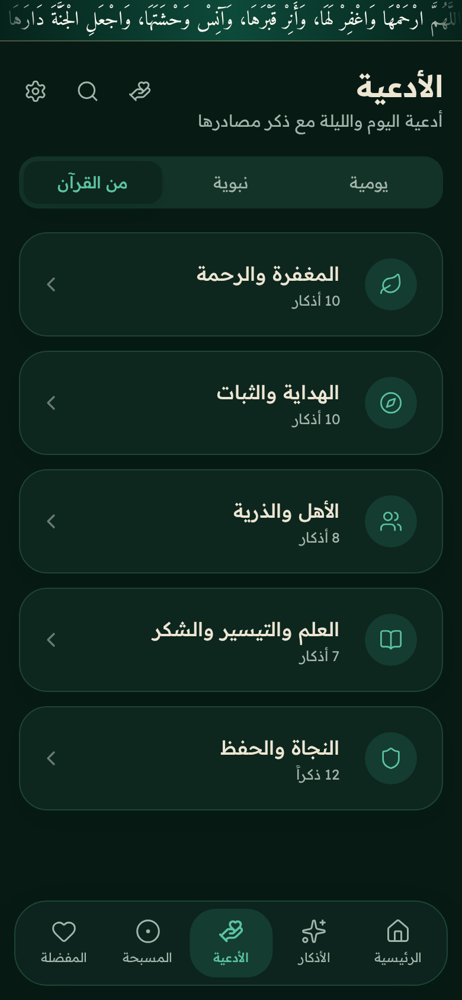
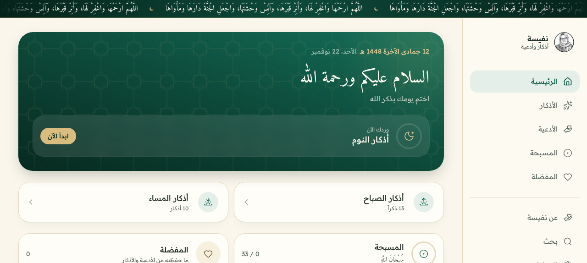
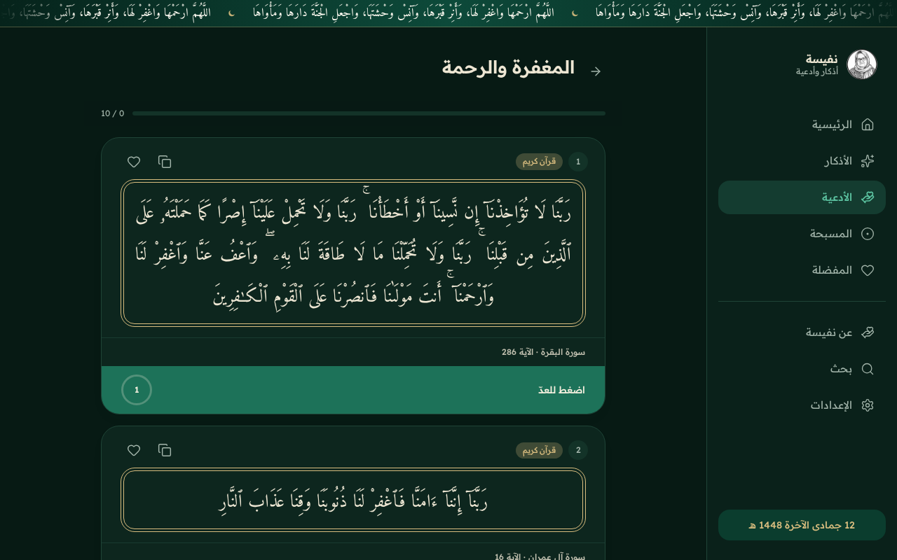

<div align="center">


# Nafissa

An Arabic, offline-first web app for daily adhkar and duas, with a tasbih counter. It is not a Quran reader.

[العربية](README.ar.md) · English

</div>

> [!IMPORTANT]
> The content of this app has been checked by software against its sources. It has not been reviewed by a qualified Islamic scholar, and the app is not a certified religious reference. See [Religious disclaimer](#religious-disclaimer).

## Overview

Nafissa is a progressive web app, in Arabic and laid out right to left, that puts the daily remembrances and supplications a Muslim uses most in one calm, fast place. It installs to a phone's home screen, works with no connection, and keeps everything on the device. There are no accounts, no ads and no tracking.

It is a static site with no server, built to be hosted on GitHub Pages.

## Features

- Daily adhkar: morning, evening, after prayer, sleep, waking and general remembrance, with a repetition counter and daily progress for each.
- Everyday duas grouped by situation and prophetic supplications, each with its collection, hadith number and attributed grading. Supplications from the Quran form one category among them, each shown as an individual supplication with its surah and ayah.
- Tasbih counter with presets, custom targets, rounds, a completion animation and optional haptic feedback. A count is never cleared without being asked.
- Favorites, saved on the device and grouped by section.
- Export and import of favorites and counters to a file, with a preview before anything is applied. This is also how data moves between the browser and the installed app. See [`docs/product/backup-format.md`](docs/product/backup-format.md).
- Arabic search that ignores vocalization and tolerates common spelling variants.
- Home screen with the Hijri date (adjustable by up to two days for local moon sighting), a suggested wird for the time of day, and a dhikr and dua of the day.
- Light and dark themes, adjustable text size for supplications, Eastern or Western digits.
- Installable, fully offline after the first visit, with updates that wait for your consent.

## Screenshots

| Home | Reader | Tasbih | Dark mode |
|---|---|---|---|
|  |  |  |  |

| Desktop | Desktop, dark |
|---|---|
|  |  |

## Installation

To use the app, open the deployed site and add it to your home screen:

- Android, Chrome: open the menu and choose "Install app".
- iPhone and iPad, Safari: tap Share, then "Add to Home Screen".
- Desktop Chrome or Edge: use the install icon in the address bar.

After the first visit the app opens and works without a connection.

### Browser support

Nafissa is tested in Chrome on Android and desktop, and in Safari on iPhone and desktop (through the WebKit engine).

Firefox is not supported for now and is not part of the automated tests. During testing, Firefox's page process crashed intermittently on the settings screen while the accessibility scanner was running: a segmentation fault inside Firefox, seen on two machines, whose cause was not found. The app may well work in Firefox, but nothing checks that it does.

## Local development

Requires Node 24 or later.

```
git clone https://github.com/MHChlagou/bayssa.git
cd bayssa
npm install
npm run dev
```

The app is served at `http://localhost:5173/bayssa/`.

| Command | What it does |
|---|---|
| `npm run dev` | Development server |
| `npm run lint` | ESLint |
| `npm run typecheck` | TypeScript, strict |
| `npm test` | Unit tests |
| `npm run test:e2e` | End-to-end tests against the production build in Chromium and WebKit. Run `npx playwright install chromium webkit` once first. Firefox is not tested: see Browser support. |
| `npm run content:validate` | Checks the content dataset, including the Quran text character for character |
| `npm run content:audit` | Regenerates the content audit reports (needs `npm run content:fetch` first) |
| `npm run build:public` | Builds to `dist-public/` with only the content whose redistribution rights are documented, then scans the result for anything else |
| `npm run test:public` | Smoke tests for that public build |

## Build

```
npm run build
npm run preview
```

The build validates the content, type-checks, prerenders the home screen to static HTML and writes the site and its service worker to `dist/`.

## Deployment to GitHub Pages

1. Create a repository named `bayssa`. For another name, change `BASE_PATH` in `vite.config.ts`.
2. In the repository settings, under Pages, set the source to "GitHub Actions".
3. Under Settings, Secrets and variables, Actions, Variables, add a repository variable `DEPLOY_PAGES` with the value `true`.
4. Push to `main`. The workflow in `.github/workflows/ci.yml` validates the content, runs every test, builds and deploys.

Deployment is off by default. Without that variable, or in a private repository, the workflow only verifies and builds, and publishes nothing.

The site is published at `https://mhchlagou.github.io/bayssa/`. The workflow passes that address to the build so link previews use absolute URLs.

## PWA and offline

- Every file the app needs, including the content and the fonts, is cached on the first visit. The app makes no network request after that and none to any third party at any time.
- Routing uses the URL hash, so any screen can be opened directly and offline on a static host.
- When a new version is published the app shows a prompt and keeps running the old version until you accept, so a dhikr in progress is never interrupted.
- Favorites, tasbih counts, progress and preferences are stored in the browser's local storage.

## Technology

React 19, TypeScript, Vite 8, Tailwind CSS 4, React Router (hash routing), Motion, Lucide icons, vite-plugin-pwa with Workbox, Vitest and Playwright. Fonts: Amiri for Quran and supplications, Readex Pro for the interface, both self-hosted.

## Content sourcing and verification

No religious text in this project is typed by hand. A script cuts every recited word from a reference source.

- Quran: the Uthmani text of the [Tanzil Project](https://tanzil.net), version 1.1, shown unchanged. Every build compares each Quran passage with the Tanzil file character for character and fails on any difference.
- Supplications: taken from حصن المسلم by Sa'id ibn Ali ibn Wahf al-Qahtani, then compared by script with the Arabic text of the six hadith collections (al-Bukhari, Muslim, Abu Dawud, at-Tirmidhi, an-Nasa'i, Ibn Majah).
- An entry is published only if its wording is found in one of those collections under a citable number, its repetition count is stated in the source text, and it is in al-Bukhari or Muslim or carries a sahih or hasan grading attributed to a named scholar.
- Text match is reported as exact (the wording is found as it is) or approximate (at least 90% of the words in order). Approximate entries are labelled on their cards.
- Entries that fail a check stay in the repository and out of the app. Entries can also be held by a recorded editorial decision.

Current figures: 205 entries published (51 Quran passages, 120 exact matches, 34 approximate matches) and 77 hidden.

Every entry records where its wording, references and explanation come from, and whether a scholar has reviewed it. See [`docs/pre-release/provenance.md`](docs/pre-release/provenance.md).

The full method, its known weaknesses and the audit of every published entry are in [`content-sources/README.md`](content-sources/README.md) and [`docs/pre-release/content-audit.md`](docs/pre-release/content-audit.md).

## Religious disclaimer

- The verification described above is mechanical. A program compared letters. It is not a ruling on authenticity and it is not a scholar's review.
- No qualified Islamic scholar has reviewed this content. The app is not certified, endorsed or approved by any scholar or religious body.
- Matching by wording can attach a supplication to a narration about a different occasion. The audit found and removed such cases, and others may remain. A hadith number shown in the app may be one of several candidates.
- Gradings are quoted from a third-party dataset, with the name of the scholar they are attributed to. They are not the project's own judgment.
- For rulings, and wherever accuracy matters to you, consult a qualified scholar and the original books.
- If you find a mistake, please open a content correction issue and name your source.

## Privacy

The app has no accounts, no analytics, no advertising and no cookies. It sends nothing about you anywhere. Favorites, counts and preferences stay in your browser's storage on your device and are lost if you clear that storage. The app loads no resource from any third party.

## Licence

No licence is in force for this repository yet. The structure decided on keeps two things apart:

- the application source code, to be released under the Apache License 2.0 once the licensing review is complete;
- third-party content (supplication text, Quran passages, fonts), which stays under its own holders' terms and is not covered by the code licence. See [`THIRD_PARTY_CONTENT.md`](THIRD_PARTY_CONTENT.md).

One content permission is still being sought, and the origin of the reference data is being clarified. See [`docs/pre-release/licensing.md`](docs/pre-release/licensing.md).

## Credits

- [Tanzil Project](https://tanzil.net) for the verified Quran text.
- Shaykh Sa'id ibn Ali ibn Wahf al-Qahtani, may Allah have mercy on him, author of حصن المسلم.
- [fawazahmed0/hadith-api](https://github.com/fawazahmed0/hadith-api) for the open hadith dataset used for references and gradings.
- Khaled Hosny and the Amiri project, and the Readex Pro authors, for the fonts.
- The authors of the open-source libraries listed above.

## Contributing

See [`CONTRIBUTING.md`](CONTRIBUTING.md). Corrections to content are especially welcome and follow a stricter process than code.
